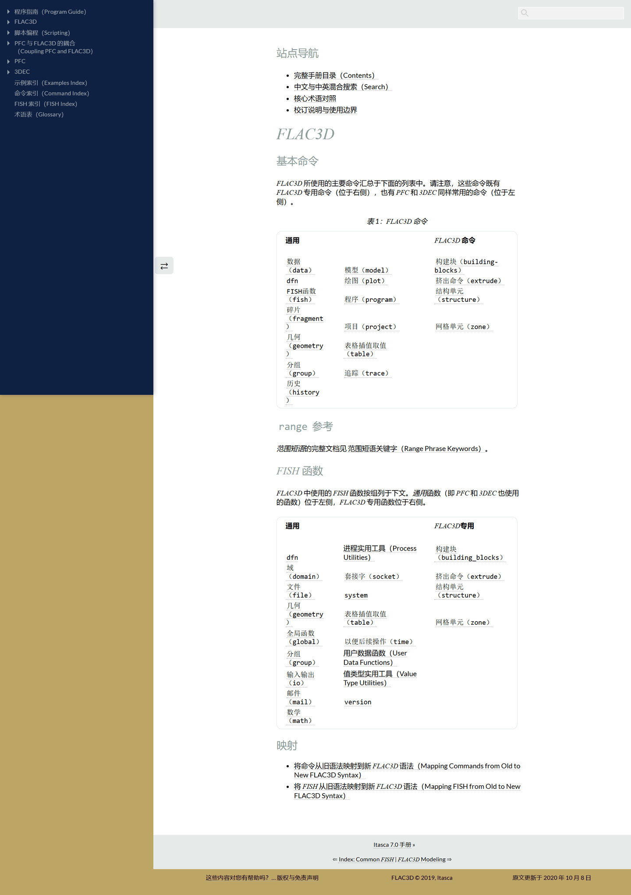

<div align="center">

# Itasca 7.0 中文手册

**FLAC3D · 3DEC · PFC 数值模拟软件文档的民间中文翻译整理站**

[](https://github.com/funj-student/itasca-docs-cn/actions/workflows/deploy-pages.yml)
[](https://github.com/funj-student/itasca-docs-cn/actions/workflows/term-check.yml)


[在线阅读](https://funj-student.github.io/itasca-docs-cn/) ·
[完整目录](https://funj-student.github.io/itasca-docs-cn/doc/contents.html) ·
[全文检索](https://funj-student.github.io/itasca-docs-cn/doc/search.html) ·
[术语速查](https://funj-student.github.io/itasca-docs-cn/terms.html)

</div>

---

## 项目简介

本项目将 Itasca 7.0 官方英文手册翻译整理为简体中文，覆盖 **FLAC3D**（有限差分法岩土分析）、**3DEC**（离散元法块体分析）与 **PFC**（颗粒流分析）三大分册，共 6,577 个 HTML 页面。站点保留原版手册的章节结构与交互方式，并在此基础上补充中文全文检索、专业术语对照与逐条校订记录。

访问 [funj-student.github.io/itasca-docs-cn](https://funj-student.github.io/itasca-docs-cn/) 即可免费阅读，无需安装任何软件。

> **重要**：本项目是民间翻译整理成果，不是 Itasca Consulting Group 官方网站，也未获官方授权。实际工程应用请以原版英文手册为准。

<div align="center">



*站点首页（PC 端）：分册导航、命令索引与全文检索入口*

</div>

## 核心功能

| 功能 | 说明 |
| --- | --- |
| 全文检索 | 支持中文、英文及中英混合关键词；提供排除词、来源、类型与标题筛选，可直达命令与锚点 |
| 分册覆盖 | FLAC3D、3DEC、PFC 及通用命令、FISH 语言、Python 脚本、理论推导与验证算例 |
| 术语体系 | [核心术语对照](https://funj-student.github.io/itasca-docs-cn/terms.html) 125 条 + [模块词库](https://funj-student.github.io/itasca-docs-cn/glossary.html) 306 条，按 5 大模块拆分 |
| 警示对齐 | [警示与适用边界](https://funj-student.github.io/itasca-docs-cn/warnings.html) 共 94 条，与官方英文版逐页比对，mismatch = 0 |
| 多端适配 | PC 侧栏目录、移动端抽屉式导航均可开合、可拖动 |
| 质量门禁 | CI 自动执行术语一致性、警示层级、链接完整性与浏览器冒烟测试 |

## 在线访问

站点地址：<https://funj-student.github.io/itasca-docs-cn/>

| 入口 | 说明 |
| --- | --- |
| [站点首页](https://funj-student.github.io/itasca-docs-cn/) | 分册导航与搜索入口 |
| [完整目录](https://funj-student.github.io/itasca-docs-cn/doc/contents.html) | 按手册章节浏览全部文档 |
| [全文检索](https://funj-student.github.io/itasca-docs-cn/doc/search.html) | 中文／英文／中英混合搜索 |
| [核心术语对照](https://funj-student.github.io/itasca-docs-cn/terms.html) | 125 条核心术语速查 |
| [模块术语词库](https://funj-student.github.io/itasca-docs-cn/glossary.html) | 306 条，按 5 大模块分类 |
| [警示汇总](https://funj-student.github.io/itasca-docs-cn/warnings.html) | 94 条风险提示与适用边界 |
| [校订说明](https://funj-student.github.io/itasca-docs-cn/about.html) | 校订范围、验证结果与使用边界 |

## 检索用法

- 中文、英文及中英混合关键词均可搜索，多个关键词用空格分隔。
- 中文／混合查询中，排除词前加减号，例如 `摩擦角 -模型`。
- 可使用来源、类型与标题筛选。
- 示例：`安全系数`、`刚性簇`、`quiet boundary`、`水力压裂 flowplane.vertex`。

由于中文搜索索引约 15 MB，首次检索需要等待索引加载；后续会使用浏览器缓存。

## 质量保障

全站经过多轮自动与人工校订，关键数据如下：

- 全量扫描 93,911 个正文及标题单元，逐项复核 216 个机械检查候选。
- 记录 1,572 个修订条目（见 `逐项校订记录.json`），直接涉及 428 个页面，共重新渲染 432 页。
- 6,573 个 HTML 页面通过结构、公式、锚点及引用身份核验，错误数 0。
- 术语 CI 检查：核心术语 125 条与官方术语表全部覆盖，禁用译字变体。
- 警示层级按官方英文版逐页比对，mismatch = 0。
- 全书逐页的人工专业终审尚未完成，详见[校订说明](https://funj-student.github.io/itasca-docs-cn/about.html)。

在仓库根目录使用 Python 3.11 可运行与 CI 相同的检查：

```sh
python -m pip install -r scripts/requirements-checks.txt
python -B -m unittest discover -s tests -v
python scripts/check_terms.py
python scripts/check_links.py --known-missing scripts/known-missing-images.json
```

PFC 7.0 的两个 Python 示例使用了缺少源图的通配符路径。CI 会按页面、原始 URL 和出现次数精确匹配这两处已知缺图；新增缺失、坏锚点或已过期的例外都会使检查失败。

## 仓库结构

- `index.html` — 站点首页：分册导航与搜索入口
- `doc/` — 完整手册（6,577 个 HTML 页面及配套图片、脚本、索引）
- `doc/contents.html` — 完整目录
- `doc/search.html` — 全文检索页；中文索引为 `doc/_static/zh-search-data.js`，按需加载
- `terms.html` / `glossary.html` — 核心术语对照（125 条）与模块词库（306 条）
- `warnings.html` — 警示与适用边界汇总（94 条）
- `about.html` / `disclaimer.html` — 校订范围、验证结果与免责声明
- `核心术语对照.md` / `术语词库.md` — 术语数据源；修改后运行 `python scripts/generate_glossary.py` 重新生成
- `scripts/` — 术语校验、链接校验、词库生成等自动化脚本
- `translation_review/` — 分批翻译审校记录与项目总账
- `tests/` — 单元测试与浏览器冒烟测试

### 本地查看

```sh
git clone https://github.com/funj-student/itasca-docs-cn.git
cd itasca-docs-cn
```

用浏览器打开 `index.html` 即可。请保留 `doc` 文件夹的完整结构，否则页面之间的链接、图片和附件会失效。

## 部署

仓库根目录包含 `.nojekyll`，确保以下划线开头的 `_static`、`_images` 目录能够正常发布。

提交到 `main` 的 Pull Request 会运行质量检查。推送到 `main` 或手动触发 Pages 工作流时，只有同一提交通过全部检查，才会上传仓库根目录并发布到现有站点。

## 参与校订

欢迎提交 Issue 或 Pull Request。请尽量提供：

1. 页面地址或文件路径；
2. 原文；
3. 当前译文；
4. 建议译法与依据（教材、规范或上下文）。

## 版权与免责声明

本项目为民间翻译整理成果，非 Itasca Consulting Group 官方网站或授权产品。FLAC3D、3DEC、PFC 及相关文档、图片和标识的版权归原出版方所有。本站仅供中文学习者免费查询与学习使用，不对软件使用结果承担责任。

详见[网页版免责声明](https://funj-student.github.io/itasca-docs-cn/disclaimer.html)或 `DISCLAIMER.md`。
